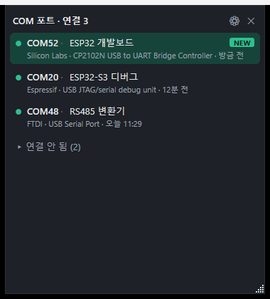

# COM Port Widget: find the COM port of the board you just plugged in

한국어: [README.md](README.md) · English (this page)

Made and maintained by [Nerdvana Inc.](https://nerdvana.co.kr) · MIT license · [Notice](NOTICE.en.md)

[](LICENSE)
[](https://github.com/nerdvanainc/com-port-widget/actions/workflows/tests.yml)
[](https://github.com/nerdvanainc/com-port-widget/releases)

A PC used for firmware work piles up COM ports. When you plug in a board it is hard to tell which number just appeared, and the numbers can climb to COM200 or COM300. COM Port Widget is a small window that lists COM ports with the most recently recognised one first and highlights the port that was just connected. You can attach a note to each device, and there is a cleanup function for the records and reserved numbers of devices that are no longer connected.



*The `--demo` mode screen. The devices and notes are made-up demo data.*

## What it does

- Lists connected COM ports newest first. Each card shows the port number, note, vendor, device description and when it was recognised.
- A port recognised within the last 5 minutes is highlighted in green with a NEW tag. The time can be set from 1 to 120 minutes in the settings.
- A device that was unplugged moves to a "Not connected" group, which starts collapsed.
- You can attach a note to each device. Click the note line and type in place.
- Plug and unplug are detected from Windows device change notifications. As a fallback for missed notifications, the list is also re-read every 30 seconds.
- "Clean up COM ports" removes the records and reserved numbers of devices that are not connected, for the items you pick (see below).
- Korean and English UI. The default follows the Windows display language.

The program never opens a COM port, so it does not get in the way of a terminal program, a flasher or a debugger that is using one. It does not use the network.

## Requirements

- Windows 10 or later, 64-bit (x64). The list and notes have no further restriction.
- The cleanup function needs Windows 10 version 2004 or later, because it uses `pnputil /remove-device`, which was added in that version.
- No separate .NET install. The runtime is inside the exe.

## Download and run

Get `ComPortWidget-<version>-win64.zip` and `SHA256SUMS.txt` from the [Releases page](https://github.com/nerdvanainc/com-port-widget/releases). The zip holds `ComPortWidget.exe`, `LICENSE`, `NOTICE.md`, `NOTICE.en.md` and `THIRD_PARTY_NOTICES.md`.

Check the download:

```powershell
Get-FileHash ComPortWidget-0.1.0-win64.zip -Algorithm SHA256
```

The value must match the one in `SHA256SUMS.txt`.

Run `ComPortWidget.exe`. There is no installer. In 0.1.0 the exe is about 72 MiB (75.5 MB). The runtime is compressed inside it, so it is smaller than the same build without compression (173 MB) and starts a little slower. On the development PC (Windows 11), the time from launch to the window appearing was 1.2 to 1.7 seconds for the compressed build and 0.9 to 1.6 seconds for the uncompressed one.

### SmartScreen warning on the first run

The executable has no code signature, so SmartScreen may show a "Windows protected your PC" warning on the first run. After checking the hash as above, choose "More info", then "Run anyway".

## Usage

- The window has no border and does not appear on the taskbar. Resize only with the grip at the bottom-right corner (the edges do not resize); position and size are saved.
- If another window covers it, bring it forward by clicking the tray icon or with the global hotkey (default `Ctrl+Alt+Shift+C`, changeable in the settings).
- Closing the window leaves the program in the tray. Exit only from the tray menu. A second launch brings the existing window forward and quits.
- Right-click an item for Copy port name, Edit note and Device info.
- On the first run it asks whether to start with Windows. You can change that later in the settings. It writes a `Run` value under `HKCU`, so no administrator rights are needed.
- The settings window has Always on top, highlight time, language, hotkey, the list of saved notes (with delete) and a "Clean up COM ports..." button.
- The window is not embedded in the desktop layer. Win+D may hide it along with everything else; bring it back from the tray or with the hotkey.
- Devices recognised in a batch right after boot or resume from sleep are not highlighted; they are labelled "at boot".

To check the screen text or take a screenshot, run `ComPortWidget.exe --demo`. It shows five made-up devices (3 connected, 2 not connected). It creates no data file, does not register itself for startup and does not query real devices.

## About the vendor name

The vendor is determined from the VID (vendor ID) the USB device reports. A VID usually identifies the company that made the USB chip, not the company that made the board. A home-made board built around a CP2102N shows "Silicon Labs" whoever built the board. A converter with an FTDI chip shows "FTDI".

A VID that is not in the built-in table is shown as a number such as `VID 1234`. For a VID that several projects share (for example `16D0`) the vendor is left blank and only the product name the device reports is shown. The driver provider that Windows reports is not used, because it makes devices such as the ESP32 show up as "Microsoft".

## When a note follows the device

A note is attached to a device key, not to a COM number. If a device moves to another USB port or gets another number, the note stays as long as the key is the same.

The note follows in these cases:

- The USB device reports a unique serial number. The key is `VID:PID:serial`, which stays the same on another USB port or behind another hub.
- For composite devices the interface number is part of the key, so the two ports of a dual-channel FTDI chip can have separate notes.
- If the serial looks like a MAC address (ESP32 family and similar), VID and PID are left out of the key. The same board keeps one note in bootloader (ROM) mode and in application mode even though the VID/PID differ.
- Cleaning up the Windows records does not delete notes. When the same device is plugged in again and gets the same key, the note is restored.

The note does not follow, or can go wrong, in these cases:

- A device without a serial. The key is the device instance ID, which depends on the USB location. The note stays on the same USB port and is lost on another one.
- Default serials that many products are known to share, such as `0001` or `123456`. Values on the built-in list are treated as no serial.
- Different devices that share a serial not on the built-in list. They cannot be told apart and share the note.
- The same MAC serial in a mode with a different interface layout (composite or not) can produce a different key.
- One line in the list is one Windows record. The ROM-mode and application-mode records of one board share a note but appear as two lines.

## Clean up COM ports

Plugging devices in and out leaves records and number reservations behind in Windows. "Clean up COM ports" in the settings window or the tray menu lets you pick some of them and remove them.

What it removes:

- Records of disconnected USB serial devices (`USB`, `FTDIBUS`): the device record and the COM number reservation.
- Only if you select them: a disconnected record with the same key as a connected device, disconnected virtual and Bluetooth port records, and numbers that are only reserved with no record (the reservation is released).

What it does not remove:

- Connected devices. They are not listed and are never processed. An item that is already connected when the cleanup starts is skipped on its own. If the last check just before removing an item finds a connected device, all remaining items are aborted. Items removed before that are not restored.
- Driver files. When you plug the device in again it is installed again automatically and gets a low free number.
- Notes and recognition times (the widget's `data.json`).

A device whose record was removed gets a newly free number when plugged in again, not necessarily the old one. A removed record cannot be restored. Before running, the original ComDB and details of the records to be removed are saved to `%APPDATA%\ComPortWidget\backup-<time>.json`. That is for investigation; the app has no undo.

Only the disconnected USB serial records are selected by default. Everything else you select yourself. Before running, the window shows what will be removed, with notes and last-seen times, plus the expected result ("N records removed, M numbers released"), and asks for one more confirmation.

### The UAC prompt shows Windows PowerShell

Removing device records needs administrator rights. The widget itself runs as a normal user and elevates only for the cleanup. This is how:

1. The widget starts the system's Windows PowerShell (`powershell.exe`) through UAC.
2. That PowerShell creates the folder `C:\Program Files\ComPortWidget-Cleanup-<GUID>` and copies the running exe into it. It checks that the copy has the same hash as the original.
3. It runs the copy in the cleanup-only mode. Because the copy runs from a location ordinary users cannot write to, a DLL planted next to the original exe cannot be loaded with administrator rights.
4. When it finishes, the temporary folder is deleted.

This is why the UAC prompt shows "Windows PowerShell" and not the app name. The exe is unsigned, so elevating the exe directly would show "Unknown publisher"; with this method what gets elevated is Windows' own PowerShell. While the cleanup runs, the temporary folder is visible under Program Files, and it is gone afterwards.

Cleanup does not run from a development build (`dotnet run`). It runs only from the exe published as a single file.

The limits that remain are listed in [NOTICE.en.md](NOTICE.en.md).

## Privacy and network

The program does not use the network. There is no telemetry, update check or error reporting. Notes, observed connect and disconnect times, and settings are stored in `%APPDATA%\ComPortWidget\data.json`. Running the cleanup also leaves `backup-<time>.json` and `reset-result.json` in the same folder. They contain device instance IDs (including USB serial numbers) and the app does not delete them, so delete them yourself if you do not need them. On an unhandled error the exception text is appended to `crash.log` in the same folder (not written in `--demo`); it is never sent anywhere.

## Build from source

You need the .NET 10 SDK (see `global.json`).

```powershell
dotnet build ComPortWidget.sln -c Release
dotnet test ComPortWidget.sln -c Release
pwsh packaging/make_release.ps1 -Version 0.1.0   # writes the zip and SHA256SUMS.txt under dist/
```

The unit tests use xUnit and cover device identification, list order and highlighting, storage, the cleanup plan and its safeguards, and the elevation script. Removing real device records is not part of the automated tests.

## License

The source code is under the MIT license. See [LICENSE](LICENSE). Parts of the .NET runtime bundled in the release exe are under Microsoft terms; the split by file is in [THIRD_PARTY_NOTICES.md](THIRD_PARTY_NOTICES.md). Changes are in [CHANGELOG.en.md](CHANGELOG.en.md).

## About the company

[Nerdvana Inc.](https://nerdvana.co.kr) develops embedded hardware, firmware and software. Product page: [nerdvana.co.kr/com-port-widget](https://nerdvana.co.kr/com-port-widget/)
