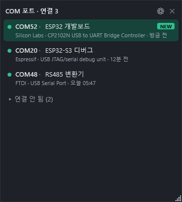

# COM Port Widget: 방금 꽂은 장비의 COM 포트를 바로 찾는 Windows 위젯

한국어(이 페이지) · English: [README.en.md](README.en.md)

제작·유지보수: [Nerdvana Inc.](https://nerdvana.co.kr) (㈜너드바나) · 라이선스 MIT · [고지](NOTICE.md)

[](LICENSE)
[](https://github.com/nerdvanainc/com-port-widget/actions/workflows/tests.yml)
[](https://github.com/nerdvanainc/com-port-widget/releases)

펌웨어를 개발하는 PC에는 COM 포트가 금방 쌓입니다. 보드를 새로 꽂아도 어느 번호가 방금 생긴 것인지 알기 어렵고, 번호가 COM200, COM300까지 올라가기도 합니다. COM Port Widget은 작은 창으로 COM 포트 목록을 최근 인식 순으로 보여 주고, 방금 연결된 포트를 하이라이트합니다. 장비마다 메모를 달 수 있고, 연결되지 않은 장비의 기록과 예약 번호를 정리하는 기능도 있습니다.



*`--demo` 모드 화면입니다. 장치와 메모는 모두 시연용 가짜 데이터입니다.*

## 무엇을 하는 도구인가

- 연결된 COM 포트를 인식 시간 내림차순으로 보여 줍니다. 포트 번호, 메모, 제조사, 장치 설명, 인식 시간이 한 카드에 나옵니다.
- 최근 5분 안에 인식된 포트는 초록색으로 하이라이트하고 NEW 표시를 붙입니다. 시간은 설정에서 1~120분으로 바꿀 수 있습니다.
- 뽑힌 장비는 "연결 안 됨" 그룹으로 내려갑니다. 이 그룹은 처음에는 접혀 있습니다.
- 장비마다 메모를 달 수 있습니다. 메모 줄을 클릭해 그 자리에서 입력합니다.
- 연결과 해제는 Windows의 장치 변경 알림으로 감지하고, 알림을 놓칠 때를 대비해 30초마다 목록을 다시 읽습니다.
- 연결되지 않은 장비의 기록과 예약 번호를 골라서 지우는 "COM 포트 정리" 기능이 있습니다(아래 참조).
- 한국어와 영어를 지원합니다. 기본은 Windows 표시 언어를 따릅니다.

COM 포트를 열지 않으므로 터미널 프로그램, 플래셔, 디버거가 쓰는 포트를 방해하지 않습니다. 네트워크도 쓰지 않습니다.

## 요구 사항

- Windows 10 버전 1903 이상, 64비트. .NET Framework 4.8은 이 버전부터 Windows에 들어 있어서 따로 설치할 것이 없습니다.
- COM 포트 정리 기능은 Windows 10 버전 2004 이상이 필요합니다. 장치 기록 삭제에 쓰는 `pnputil /remove-device`가 그 버전부터 있습니다.

## 다운로드와 실행

[Releases 페이지](https://github.com/nerdvanainc/com-port-widget/releases)에서 `ComPortWidget-<버전>-win64.zip`과 `SHA256SUMS.txt`를 받습니다. 압축 파일 안에는 `ComPortWidget-<버전>` 폴더가 있고, 그 안에 `ComPortWidget.exe`, `LICENSE`, `NOTICE.md`, `NOTICE.en.md`, `THIRD_PARTY_NOTICES.md`가 들어 있습니다.

받은 파일이 맞는지 확인합니다.

```powershell
Get-FileHash ComPortWidget-0.1.0-win64.zip -Algorithm SHA256
```

출력된 값이 `SHA256SUMS.txt`에 적힌 값과 같아야 합니다.

압축을 푼 폴더에서 `ComPortWidget.exe`를 실행하면 끝입니다. 설치 프로그램은 없습니다. 0.1.0 기준으로 exe는 약 210 KiB, zip은 약 98 KiB입니다. 압축은 다운로드 폴더, 공유 폴더, 동기화되는 폴더에 풀지 말고 이 프로그램만 들어 있는 폴더에 푸십시오. exe 옆에 `.config` 파일 같은 다른 파일이 있으면 프로그램이 그 내용대로 코드를 실행할 수 있습니다. 정리 기능을 쓰는 PC에서는 `C:\Program Files` 아래처럼 관리자만 쓸 수 있는 폴더에 두면 더 안전합니다(자세한 내용은 [NOTICE.md](NOTICE.md)).

### 처음 실행할 때 SmartScreen 경고

실행 파일에 코드 서명이 없어서 처음 실행하면 "Windows의 PC 보호" 같은 SmartScreen 경고가 뜰 수 있습니다. 위에서 해시를 확인한 뒤 "추가 정보"에서 "실행"을 누르면 됩니다.

## 사용 방법

- 창은 테두리가 없고 작업 표시줄에 나타나지 않습니다. 크기는 오른쪽 아래 모서리의 크기 조절 손잡이를 끌어서만 바꿀 수 있고(가장자리는 안 됩니다), 위치와 크기는 저장됩니다.
- 다른 창에 가려지면 트레이 아이콘을 클릭하거나 전역 단축키(기본 `Ctrl+Alt+Shift+C`)로 앞으로 가져옵니다. 단축키는 설정에서 바꿀 수 있습니다.
- 창을 닫아도 트레이에 남아 있습니다. 종료는 트레이 메뉴의 "종료"에서만 합니다. 두 번째 실행은 기존 창을 앞으로 가져오고 끝납니다.
- 항목을 우클릭하면 포트 이름 복사, 메모 편집, 장치 정보 보기를 고를 수 있습니다.
- 첫 실행 때 Windows 시작 시 자동 실행 여부를 묻습니다. 설정에서 나중에 바꿀 수 있고, 켜면 `HKCU` 아래 Run 항목을 쓰므로 관리자 권한이 필요 없습니다.
- 설정 창에는 항상 맨 위, 하이라이트 시간, 언어, 단축키, 저장된 메모 목록(삭제 가능), "COM 포트 정리…" 버튼이 있습니다.
- 바탕화면 계층에는 끼워 넣지 않습니다. 그래서 Win+D를 누르면 위젯도 함께 숨겨질 수 있고, 트레이나 단축키로 되돌립니다.
- 부팅이나 절전 복귀 직후에 한꺼번에 인식된 장비는 하이라이트하지 않고 "부팅 시 인식"이라고 표시합니다.

화면 문구를 확인하거나 스크린샷을 찍을 때는 `ComPortWidget.exe --demo`로 실행합니다. 가짜 장치 5개(연결 3, 미연결 2)를 보여 줍니다. 데이터 파일을 만들지 않고, 시작 프로그램에 등록하지 않고, 실제 장치를 조회하지 않습니다.

## 제조사 표시에 대해

제조사는 USB 장치가 알려 주는 VID(제조사 번호)로 판별합니다. VID가 가리키는 것은 대개 장비를 만든 회사가 아니라 USB 칩을 만든 회사입니다. CP2102N 칩을 쓴 자체 제작 보드는 보드 제작사와 상관없이 "Silicon Labs"로 나옵니다. FTDI 칩을 쓴 변환기는 "FTDI"로 나옵니다.

내장 표에 없는 VID는 `VID 1234`처럼 번호로 표시합니다. 여러 프로젝트가 나눠 쓰는 VID(예: `16D0`)는 제조사를 비워 두고 장치가 보고한 제품명만 보여 줍니다. Windows의 드라이버 제공자 정보는 쓰지 않습니다. ESP32 같은 장비가 "Microsoft"로 나오기 때문입니다.

## 메모가 장비를 따라가는 조건

메모는 COM 번호가 아니라 장비 키에 붙습니다. 장비를 다른 USB 포트에 꽂거나 번호가 바뀌어도, 같은 키로 인식되면 메모가 남습니다.

메모가 따라오는 경우:

- USB 장치가 고유 시리얼을 보고하는 경우. 키는 `VID:PID:시리얼`입니다. 다른 USB 포트, 다른 허브에 꽂아도 같은 키입니다.
- 복합 장치는 인터페이스 번호를 키에 포함합니다. 2채널 FTDI 칩의 두 포트에 메모를 따로 달 수 있습니다.
- 시리얼이 MAC 주소 형식인 보드(ESP32 계열 등)는 VID/PID를 키에서 뺍니다. 같은 보드가 부트로더(ROM) 모드와 앱 모드에서 VID/PID가 달라도 같은 메모를 씁니다.
- 정리 기능으로 Windows 기록을 지워도 메모는 남습니다. 같은 장비를 다시 꽂아 같은 키가 되면 복원됩니다.

메모가 따라오지 않거나 어긋나는 경우:

- 시리얼이 없는 장비. 키가 장치 인스턴스 ID(USB 위치 기반)가 되므로 같은 USB 포트에서는 유지되지만, 다른 포트에 꽂으면 다른 장비로 취급합니다.
- `0001`, `123456`처럼 여러 제품이 같은 값을 쓰는 것으로 알려진 기본 시리얼. 내장 목록에 있는 값은 시리얼이 없는 것으로 처리합니다.
- 내장 목록에 없는데 서로 다른 장비가 같은 시리얼을 쓰는 경우. 구분하지 못하고 메모가 공유됩니다.
- 같은 MAC 시리얼이라도 인터페이스 구성이 다른 모드(복합 장치 여부가 다른 경우)는 키가 달라질 수 있습니다.
- 목록의 한 줄은 Windows 기록 하나입니다. 같은 보드의 ROM 모드와 앱 모드는 메모를 공유하지만 목록에는 두 줄로 나옵니다.

## COM 포트 정리

장비를 꽂고 뽑다 보면 Windows에 기록과 번호 예약이 계속 쌓입니다. 설정 창의 "COM 포트 정리…" 또는 트레이 메뉴에서 이 기록을 골라 지울 수 있습니다.

지우는 것:

- 연결되지 않은 USB 시리얼 기록(`USB`, `FTDIBUS`): 장치 기록과 COM 번호 예약.
- 선택했을 때만: 연결 중인 장비와 같은 키의 미연결 기록, 연결되지 않은 가상·블루투스 포트 기록, 기록 없이 예약만 남은 번호(예약만 해제).

지우지 않는 것:

- 연결된 장비. 목록에 나오지 않고, 어떤 경우에도 처리하지 않습니다. 정리를 시작할 때 이미 연결되어 있던 항목은 그 항목만 건너뜁니다. 항목을 지우기 직전의 마지막 확인에서 연결된 장치가 발견되면 남은 항목 전체를 중단합니다. 그 전에 지워진 항목은 되돌려지지 않습니다.
- 드라이버 파일. 장비를 다시 꽂으면 자동으로 다시 설치되고, 그때 비어 있는 낮은 번호를 받습니다.
- 메모와 인식 기록(위젯의 `data.json`).

기록을 지운 장비를 다시 꽂으면 이전 번호가 아니라 새로 비어 있는 번호를 받습니다. 지운 기록은 되돌릴 수 없습니다. 실행 전에 ComDB 원본과 삭제 대상 정보를 `%APPDATA%\ComPortWidget\backup-<시각>.json`에 저장하지만, 이는 조사용이고 앱에 되돌리기는 없습니다.

기본으로 선택되는 것은 미연결 USB 시리얼 기록뿐입니다. 나머지는 직접 선택해야 합니다. 실행 전에 지워질 항목, 메모, 마지막 인식 시간, 예상 결과("기록 N개 삭제, 번호 M개 해제")가 나오고, 한 번 더 확인합니다.

### 정리할 때 UAC에 "확인할 수 없는 게시자"가 표시됩니다

장치 기록 삭제에는 관리자 권한이 필요합니다. 위젯 본체는 일반 권한으로 돌고, 정리를 실행할 때만 같은 `ComPortWidget.exe`를 정리 전용 모드로 다시 실행하면서 UAC로 승격합니다. exe에 코드 서명이 없으므로 UAC 창에는 `ComPortWidget.exe`가 "확인할 수 없는 게시자"로 표시됩니다. 서명이 없는 프로그램은 항상 이렇게 나옵니다.

정리 전용 모드는 창을 만들지 않고, 계획 파일을 다시 검증한 뒤 선택한 항목만 처리합니다. 시스템 DLL은 System32에서만 읽도록 제한해 두었습니다.

남아 있는 한계는 [NOTICE.md](NOTICE.md)에 적었습니다.

## 개인정보와 네트워크

네트워크를 쓰지 않습니다. 텔레메트리, 업데이트 확인, 오류 보고가 없습니다. 메모, 직접 관측한 연결·해제 시각, 설정은 `%APPDATA%\ComPortWidget\data.json`에 저장합니다. 정리를 실행하면 같은 폴더에 `backup-<시각>.json`과 `reset-result.json`도 남습니다. 이 둘에는 장치 인스턴스 ID(USB 시리얼 포함)가 들어 있고, 앱이 지우지 않으므로 필요 없으면 직접 지우십시오. 처리되지 않은 오류가 나면 예외 내용을 같은 폴더의 `crash.log`에 남기며(`--demo`에서는 쓰지 않습니다), 어디에도 보내지 않습니다.

## 소스에서 빌드

.NET SDK(`global.json` 참조)와 .NET Framework 4.8 개발자 팩이 필요합니다. 앱은 .NET Framework 4.8 대상이고, Core와 Platform의 소스를 앱 프로젝트가 직접 포함해서 exe 하나로 빌드됩니다.

```powershell
dotnet build ComPortWidget.sln -c Release
dotnet test ComPortWidget.sln -c Release
pwsh packaging/make_release.ps1 -Version 0.1.0   # dist/ 아래에 zip과 SHA256SUMS.txt 생성
```

단위 테스트는 xUnit이며 장비 식별 규칙, 목록 정렬과 하이라이트, 저장 파일 형식, 정리 계획과 안전장치, 실행 인자 처리를 다룹니다. 실제 장치 기록을 지우는 동작은 자동 테스트에 포함되지 않습니다.

## 라이선스

소스 코드는 MIT입니다. [LICENSE](LICENSE) 참조. 릴리스 exe에는 서드파티 코드가 들어 있지 않습니다([THIRD_PARTY_NOTICES.md](THIRD_PARTY_NOTICES.md)). 변경 내역은 [CHANGELOG.md](CHANGELOG.md)에 있습니다.

## 회사 소개

[Nerdvana Inc.](https://nerdvana.co.kr)(㈜너드바나)는 임베디드 하드웨어, 펌웨어, 소프트웨어를 개발합니다. 소개 페이지: [nerdvana.co.kr/com-port-widget](https://nerdvana.co.kr/com-port-widget/)
